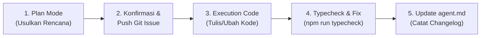

# AGENT.MD — PANDUAN KONTEKS & PROTOKOL PENGEMBANGAN JOGJAHUB

Dokumen ini adalah sumber kebenaran (*Single Source of Truth*) dan referensi konteks persisten bagi AI Agent (dan developer) dalam memelihara serta mengembangkan ekosistem **JogjaHub**.

---

## 1. Konteks Bisnis & PRD Ringkas

### 1.1 Latar Belakang & Problem Statement
Yogyakarta adalah kota pelajar dengan ribuan wisudawan per periode wisuda. Mahasiswa sering menghadapi:
1. Antrean dini hari tanpa kepastian untuk layanan kecantikan (MUA, salon, penataan rambut).
2. Ketiadaan kepastian ukuran/model busana wisuda di butik.
3. Kesulitan keluarga dari luar kota dalam mencari penginapan terdekat dari kampus.
4. Kebutuhan *gifting* (selempang, plakat, buket bunga, akrilik) yang terpisah-pisah.

**JogjaHub** adalah platform agregator mobile satu pintu yang mengintegrasikan tiga kategori utama:
- **Beauty & Style** (Salon, MUA, Butik)
- **Hotel / Penginapan**
- **Gifting** (Florist, Selempang, Plakat, Akrilik)

### 1.2 Aktor Sistem (Multi-Role)
1. **Customer** (Mahasiswa/Keluarga): Menjelajahi katalog, melihat lokasi vendor di peta, memilih slot waktu (termasuk slot dini hari), melakukan booking, mengunggah bukti bayar manual, membatalkan pesanan (sesuai ketentuan), dan memberi ulasan.
2. **Vendor / Tenant**: Mendaftar, melengkapi profil bisnis & kategori layanan, mengelola katalog produk/layanan, mengelola jadwal/slot waktu, menerima atau menolak pesanan masuk, serta memantau omzet/performa.
3. **Admin**: Memverifikasi & *approve/reject* pendaftaran vendor baru, memantau transaksi, serta menangani pengaduan/kualitas layanan.

### 1.3 Batasan Ruang Lingkup MVP (3 Bulan)
- **IN-SCOPE**:
  - Autentikasi Multi-Role terpisah (`Customer`, `Vendor`, `Admin`).
  - Onboarding & Approval Vendor (`pending` $\rightarrow$ `approved` / `rejected`).
  - Kategori, Sub-kategori, dan Filter Spesifik.
  - Integrasi Peta Lokasi (pinpoint vendor DIY).
  - Sistem Pemesanan Berbasis Slot Waktu (*Time Slot Capacity* dengan pencegahan overbooking/race condition).
  - Manajemen Pesanan (Vendor: Konfirmasi/Tolak; Customer: List Booking & Batalkan).
  - Pembayaran Manual (Transfer rekening + Unggah bukti bayar atau COD / Pay on Arrival).
- **OUT-OF-SCOPE (Jangan Diimplementasikan di MVP)**:
  - **Live Chat / Direct Messaging In-App**: **Ditiadakan**. Komunikasi langsung dialihkan ke **WhatsApp** eksternal vendor.
  - **Payment Gateway Otomatis** (Midtrans, Xendit, dll.): **Ditiadakan** untuk versi MVP.
  - **Multi-Bahasa & Multi-Mata Uang**: Hanya Bahasa Indonesia & Rupiah (IDR).
  - **Loyalty Program / Kupon Promo**: Ditunda ke versi pasca-MVP.

---

## 2. Arsitektur Teknis & Stack

### 2.1 Mobile App (`jogjahub-mobile`)
- **Framework**: React Native + Expo (Expo SDK 54 / React 19 / React Native 0.81).
- **Arsitektur Folder**: *Feature-Driven Architecture* (`src/features/{auth,customer,vendor,admin,shared}`).
- **Navigasi**: React Navigation v6 (`@react-navigation/native-stack`, `@react-navigation/bottom-tabs`).
- **State Management**: Redux Toolkit (`@reduxjs/toolkit`, `react-redux`).
- **Styling**: React Native `StyleSheet` murni dengan token desain konsisten (`src/constants/theme/`).
- **HTTP Client**: Axios (`src/api/client.ts`) dengan Interceptor Bearer Token Sanctum.
- **Penyimpanan Sesi**: `@react-native-async-storage/async-storage` (wajib persisten).

### 2.2 Backend (`jogjahub-backend`)
- **Framework**: PHP 8.3 + Laravel 11.x.
- **Database**: MySQL 8.0.
- **Autentikasi API**: Laravel Sanctum (token-based).
- **Role RBAC**: `customer`, `tenant` (vendor), `admin`.
- **Fitur Kritis**: `lockForUpdate()` saat booking untuk mencegah *race condition* slot dini hari.
- **Upload File**: Disimpan di `storage/app/public` melalui FormRequest multipart.

---

## 3. Peta Folder & Status Implementasi

```
JogjaHub/
├── agent.md                        # Panduan AI, workflow, dan riwayat pembaruan
├── prd-jogjahub.md                 # PRD utama
├── frontend-guideline-jogjahub.md  # Panduan frontend
├── backend-guideline-jogjahub.md   # Panduan backend
├── erd-diagram.md                  # Skema database relasional
├── Roadmap_Backend_JogjaHub.md     # Roadmap sprint backend
│
├── jogjahub-backend/               # REST API Laravel 11
│   ├── app/Http/Controllers/Api/   # Controller per role (Customer, Tenant, Admin, Auth)
│   ├── app/Services/BookingService # Business logic booking & slot capacity locking
│   ├── routes/api.php              # Route API v1 (auth, categories, tenants, services, bookings)
│   └── database/migrations/        # Migrasi tabel database
│
└── jogjahub-mobile/                # Aplikasi Mobile React Native (Expo)
    └── src/
        ├── api/                    # authApi, vendorApi, bookingApi, categoryApi, timeSlotApi, uploadApi
        ├── components/             # Reusable UI (Button, Input, Card, Modal, EmptyState, SlotPicker)
        ├── constants/              # theme (colors, typography, spacing), config, categories
        ├── features/
        │   ├── auth/               # [STATUS: READY] Login, Register Customer & Vendor, Role Switching
        │   ├── vendor/             # [STATUS: ~75% READY] Dashboard, Listing/CRUD Service, Incoming Orders, Calendar
        │   ├── customer/           # [STATUS: GAP BESAR]
        │   │   ├── home/           # HomeScreen (UI ada, perlu integrasi dinamis & copywriting)
        │   │   ├── catalog/        # CatalogScreen (STUB: return null)
        │   │   ├── vendor-detail/  # VendorDetailScreen (STUB: return null)
        │   │   ├── booking/        # BookingScreen & BookingConfirmationScreen (UI ready)
        │   │   ├── my-bookings/    # MyBookingsScreen & BookingDetailScreen (STUB: return null)
        │   │   └── profile/        # CustomerProfileScreen (STUB: return null)
        │   ├── admin/              # [STATUS: STUB] PendingVendors, Monitoring, Dashboard (return null)
        │   └── shared/             # Notifications, Onboarding Splash
        ├── navigation/             # RootNavigator, CustomerStackNavigator/Tab, VendorTab/Stack, AdminTab
        ├── services/               # tokenStore (perlu AsyncStorage), mapService, fileUploadService
        ├── store/                  # Redux store & authSlice
        ├── types/                  # Type definitions (user, vendor, booking, payment)
        └── utils/                  # dateHelpers, formatCurrency, orderTracking, validators
```

---

## 4. STANDAR OPERASIONAL PROSEDUR (SOP) WORKFLOW PENGEMBANGAN

Setiap AI Agent atau developer yang bekerja pada repositori ini **WAJIB** mengikuti 4 tahap berikut secara berurutan:



### Tahap 1: Plan Mode (Rencana Sebelum Koding)
- Analisis kebutuhan dan file yang akan diubah/dibuat.
- **JANGAN MENGUBAH KODE TERLEBIH DAHULU**.
- Jelaskan secara transparan kepada user:
  1. Latar belakang & tujuan perubahan.
  2. Daftar file yang akan ditambah/diubah/dihapus.
  3. Rincian logika atau UI yang akan diterapkan.
- Minta persetujuan user sebelum melangkah ke tahap berikutnya.

### Tahap 2: Push Issue ke GitHub
- Setelah rencana disepakati bersama user, buat GitHub Issue pada repositori `Gabriell550/JogjaHub` agar terdokumentasi dan dapat dilanjutkan oleh AI lain atau anggota tim.
- Format GitHub Issue:
  - **Judul**: `[Modul] Deskripsi Singkat Fitur/Fix` (contoh: `[Customer] Implementasi CatalogScreen dan Filter Sub-Kategori`)
  - **Deskripsi**: Penjelasan detail apa yang akan diubah dan tujuannya.
  - **Daftar File Terdampak**: Path file yang akan dimodifikasi atau dibuat baru.
  - **Checklist Kriteria Selesai (Definition of Done)**.
- Cara Pembuatan Issue:
  - Melalui GitHub CLI (`gh issue create`), REST API GitHub, atau link issue template.

### Tahap 3: Execution Code
- Mulai melakukan modifikasi file sesuai persetujuan.
- Ikuti standar desain dan arsitektur yang sudah ada:
  - Gunakan token tema dari `src/constants/theme` (`colors`, `typography`, `spacing`, `radius`).
  - Gunakan API instance dari `src/api/client.ts`.
  - Pastikan penamaan komponen dan file konsisten.
  - Jangan menambahkan library baru tanpa persetujuan.

### Tahap 4: Typecheck & Error Fixing
- Jalankan pemeriksaan TypeScript:
  ```bash
  cd jogjahub-mobile
  npm run typecheck
  ```
- Jika ditemukan error tipe data atau import, **langsung perbaiki (*fix it*)** sampai seluruh tipe valid.
- Pastikan tidak ada *breaking change* pada modul lain.

### Tahap 5: Update `agent.md`
- Catat pembaruan sistem atau perbaikan bug di tabel **Riwayat Perubahan & Bug Fixes** di bawah ini.

---

## 5. Riwayat Perubahan & Bug Fixes (Changelog)

| Tanggal | Modul | Deskripsi Perubahan / Bug Fix | Status | Issue Ref |
| :--- | :--- | :--- | :--- | :--- |
| 2026-10-28 | Listing (Mobile) | Implementasi redesign form tambah/edit layanan tenant (issue #67): form dibagi menjadi kartu Foto & Media, Informasi Dasar, Harga, Deskripsi, dan Status; kategori/subkategori dipilih melalui satu bottom sheet dari `GET /categories`; validasi inline memetakan kesalahan backend, scroll dan fokus ke field pertama yang salah; harga tampil berformat ribuan Rupiah dengan konversi terbilang dan saran nominal; tambah/hapus foto mendukung create dan edit (`photos[]`, `remove_photos[]`), batas 10 foto JPG/PNG/WebP maksimal 5 MB; sticky CTA memperhatikan safe area dan keyboard. Status aktif ditampilkan read-only karena backend belum menerima field tersebut. README mobile diperbarui. | Selesai | #67 |
| 2026-10-28 | Calendar (Mobile) | Penyempurnaan kalender tenant berdasarkan PR #65 (issue #66): header memakai token oranye `colors.primary` dengan teks/ikon kontras; tap pertama memilih tanggal, double-tap tanggal yang sama dalam 300 ms membuka form untuk tanggal itu tanpa auto-submit; `AddSlotModal` memakai lock untuk mencegah submit ganda dan validasi duplikasi. Tipe hotel diidentifikasi dari `service.subcategory.id` yang dicocokkan dengan subkategori pada `GET /categories` di kategori `Penginapan`; input Jam Mulai/Jam Selesai hanya tampil untuk hotel. Karena `StoreTimeSlotRequest` backend tetap mewajibkan `start_time` dan `end_time` untuk semua layanan, layanan non-hotel menyembunyikan input tetapi mengirim default yang sudah ada (`08:00`–`09:00`); API tidak diubah. README mobile diperbarui. `git diff --check` lolos; `tsc --noEmit` masih memiliki 17 diagnostic di file lain, tidak ada diagnostic pada file kalender yang diubah. | Selesai | #66 |
| 2026-10-23 | Mobile & Backend (Registrasi Ulang Tenant Rejected) | Implementasi issue #59: pengajuan ulang tenant rejected kini memakai **form registrasi awal** (`RegisterVendorScreen` mode `resubmit`) — bukan `VendorOnboardingScreen`. Mobile: banner "Catatan Revisi dari Admin" tetap tampil, data lama (nama bisnis, kategori, alamat, koordinat, email, WhatsApp) ditampilkan read-only tanpa diisi ulang, hanya bagian unggah dokumen (KTP/NIB/Portofolio) yang interaktif, tombol "Simpan & Ajukan Ulang" memanggil hook baru `useResubmit` → `vendorApi.resubmitProfile` → `POST /tenant/profile/resubmit`; sukses → `setTenantStatusPending()` + reset ke `PendingApprovalScreen` (menunggu persetujuan), gagal → Toast error & status tetap rejected; `RegisterVendor` didaftarkan di pending-stack RootNavigator; `VendorOnboardingScreen` tidak lagi dipakai untuk alur rejected (tetap untuk edit profil approved). Backend: route `POST tenant/profile/resubmit` + `ProfileController@resubmit()` hanya untuk status rejected, hanya mengganti dokumen yang diunggah ulang (data profil lama dipertahankan), status → pending, `rejection_reason` di-null-kan, file lama dihapus setelah update; `ResubmitRequest` validasi minimal 1 dokumen; tenant pending/approved ditolak (422). Test baru `tests/Feature/Tenant/TenantResubmitTest.php` (5 skenario pass/fail). `php artisan test` → 65 tests OK; `npm run typecheck` → 0 error. Dokumentasi `issue-tenant-rejection-flow.md` diperbarui. | Selesai | #59 |
| 2026-10-22 | Mobile (Map Picker Register Tenant) | Implementasi issue #56: ganti peta native `react-native-maps` yang tampil kosong/tidak bisa digeser di Expo Go dengan **Leaflet + OpenStreetMap di dalam `react-native-webview`**: install `react-native-webview@13.16.1` via `npx expo install` + uninstall `react-native-maps` (bersih dari `package.json`, lockfile, node_modules, dan seluruh import di `src/`); `MapPickerModal.tsx` ditulis ulang — HTML Leaflet (pin SVG di tengah, tile `tile.openstreetmap.org`, `postMessage` untuk event `ready`/`center`/`tileError`, `baseUrl` agar tile membawa Referer), overlay spinner saat memuat, setelah 10 detik tanpa internet muncul pesan "Peta belum termuat...", tombol "Konfirmasi Lokasi" & "Gunakan Lokasi Saya" nonaktif sampai peta siap; titik lokasi dijadikan **wajib**: `RegisterVendorScreen.tsx` tambah state `locationError`, validasi `!coordinate` sebelum `registerVendor` (Toast "Titik lokasi belum dipilih" + baris berwarna merah `mapPickerRowError`/`mapPickerSubError`, request TIDAK dikirim), kirim `latitude: coordinate.latitude`/`longitude` tanpa spread kondisi, teks "Opsional — ..." diganti "Wajib dipilih — tandai lokasi usaha Anda di peta"; `useRegister.ts` ubah `latitude`/`longitude` jadi required (hapus `?`) dan append FormData tanpa kondisi. Backend TIDAK diubah (`nullable|required_with` dipertahankan agar registrasi tenant web yang belum kirim koordinat tetap diterima). `npm run typecheck` → 0 error. | Selesai | #56 |
| 2026-10-22 | Mobile & Backend (Map Picker Register Tenant) | Implementasi issue #55: Mobile — install `react-native-maps` via `npx expo install`; `app.json` daftarkan plugin `expo-location` dengan permission message; file baru `src/features/auth/components/MapPickerModal.tsx` (modal peta pin tetap tengah, posisi awal Yogyakarta `-7.7956, 110.3695`, tombol "Gunakan Lokasi Saya" memakai `expo-location` dengan pesan teks di dalam modal bila izin ditolak/GPS mati, koordinat 6 desimal); `RegisterVendorScreen.tsx` tambah satu baris "Pilih titik lokasi di peta" tepat di bawah field Alamat Lengkap (opsional, tombol X hapus titik, style meniru FileUploadField), modal dirender sebagai anak terakhir `KeyboardAvoidingView`, koordinat dikirim via spread di `handleRegister`; `useRegister.ts` tambah `latitude?`/`longitude?` di `RegisterVendorPayload` dan di-append ke FormData setelah `address`. Backend — `RegisterTenantRequest` tambah rules `nullable|required_with|numeric|between` untuk latitude/longitude; `Tenant/AuthController@register` simpan `latitude`/`longitude` di `TenantProfile::create` (kolom sudah nullable di migration); `Customer/TenantController@map` tambah `whereNotNull('latitude')->whereNotNull('longitude')` supaya tenant tanpa titik tidak muncul sebagai koordinat 0,0. `npm run typecheck` → 0 error. | Selesai | #55 |
| 2026-10-13 | Mobile & Backend (Foto Layanan) | Implementasi issue #53: URL foto mobile selalu dibangun dari path storage dengan host `API_BASE_URL`, termasuk endpoint detail/profil, sehingga tidak mempercayai host `full_url` dari `APP_URL`; alamat API mobile kini memakai `EXPO_PUBLIC_API_URL` lokal (fallback emulator Android), ditambahkan `.env.example` dan aturan ignore `.env*.local`; backend `ServiceResource.full_url` mengikuti host request via `asset()`, dengan panduan APP_URL LAN dan server `--host=0.0.0.0`/`storage:link`. Validasi silang di dua HP belum dilakukan karena tidak ada device/backend aktif. | Selesai | #53 |
| 2026-10-07 | Web (Frontend) | Implementasi issue #49: sesi admin disimpan di `sessionStorage` agar berakhir saat tab/browser ditutup, sementara sesi customer/tenant tetap memakai `localStorage`. `getSession()` menghapus sesi admin lama dari `localStorage` agar admin wajib login ulang setelah deploy; `clearSession()` membersihkan kedua storage. | Selesai | #49 |
| 2026-10-07 | Web (Frontend) | Implementasi issue #48: (1) fix bug approve/reject tenant — request web admin kini mengirim UUID (`/admin/tenants/{uuid}/approve` & `/reject`) sesuai route key `TenantProfile` (sebelumnya memakai `tenant.id` angka → 404); (2) halaman Sengketa dengan data dummy: tipe `Dispute`/`DisputeMessage`/`DisputeStatus`, mock data `features/admin/mocks/disputeMocks.ts`, daftar sengketa `/admin/disputes` (badge status warna kuning `open` / hijau `resolved`) dan ruang chat `/admin/disputes/[uuid]` (bubble chat kiri/kanan, kirim pesan sebagai Admin, tombol "Tandai Selesai"), catatan "Data contoh — belum terhubung ke backend." di UI, nav "Transaksi" diganti "Sengketa" di sidebar, folder `app/admin/bookings/` dihapus. TODO komentar disisipkan pada titik yang nanti disambungkan ke API asli. `bun run lint` → 0 error; backend tidak diubah. | Selesai | #48 |
| 2026-10-02 | Web & Backend (Admin) | Fix "approve/reject tenant pending di web admin tidak berfungsi": root cause = `TenantProfile::getRouteKeyName()` memakai `uuid` sebagai identitas publik tenant (konsisten dengan API publik `/tenants/{uuid}` & `Booking`), sedangkan frontend web admin mengirim **id numerik** ke route admin yang berbasis uuid → Laravel tidak menemukan profil dan mengembalikan 404. Solusi mengikuti konvensi desain uuid: frontend web admin (`types.ts`, `adminApi.ts`, `admin/vendors/page.tsx`) dan mobile `adminApi.ts` diubah agar mengirim **uuid** (`/admin/tenants/{uuid}/approve` & `/reject`); binding route backend tetap default berbasis uuid (tidak diubah). Tambah regression test `tests/Feature/Admin/TenantApprovalTest.php` (list pending, approve by uuid → approved, reject by uuid + alasan → rejected & rejection_reason tersimpan, non-admin → 403). | Selesai | - |
| 2026-10-02 | Web (Frontend) | Implementasi issue #47: sesi auth tidak lagi dibaca saat render awal; `useAuth` memuat sesi dari `localStorage` setelah hydration, dan layout admin menampilkan status Memuat... sebelum memvalidasi role serta mengarahkan non-admin ke `/admin-login`. | Selesai | #47 |
| 2026-09-30 | Web & Backend (Admin) | Implementasi issue #44: halaman login admin tersembunyi di `/admin-login`, guard role pada layout admin, total customer dan tenant pada summary API serta enam kartu dashboard. Tes feature memverifikasi total via route admin. | Selesai | #44 |
| 2026-09-29 | Web (Frontend) | Implementasi issue #42: dashboard admin terhubung ke API asli. Struktur layout dirapikan — Navbar/Footer publik dipindah ke route group `(site)` (URL `/`, `/login`, `/register`, `/dashboard` tetap), `/admin/*` kini memakai sidebar admin sendiri tanpa Navbar/Footer publik. `lib/api.ts` otomatis mengirim header `Authorization: Bearer` + dukungan method `PATCH`. Halaman admin dibuat ulang dengan data asli backend: dashboard (summary + polling 30 dtk), verifikasi vendor (tenant pending asli + Setujui/Tolak dengan alasan wajib dan tombol disabled), monitoring transaksi (tabel booking + filter status yang benar-benar mengirim ke backend + polling 20 dtk), dan Users ditandai "Segera Hadir". File baru: `features/admin/services/adminApi.ts`, `features/admin/components/AdminSidebar.tsx`, `app/admin/layout.tsx` (ikon SVG inline, tanpa dependency baru). `bun run lint` → 0 error; backend tidak diubah. | Selesai | #42 |
| 2026-09-27 | Web (Frontend) | Implementasi issue #40: landing page dilengkapi widget tab kategori interaktif, value props dan promo/features dengan foto wisuda Unsplash terverifikasi; CTA utama dibuat bulat, kartu layanan diberi radius/shadow sesuai spec, klaim statistik tak bersumber diganti fakta produk, dan footer mendapat kolom kategori populer. Tanpa dependency baru. | Selesai | #40 |
| 2026-09-27 | Web (Frontend) | Implementasi issue #39: landing page diberi animasi scroll-reveal (komponen baru `RevealOnScroll` berbasis IntersectionObserver, tanpa dependency baru), background dekoratif (blob blur + pola titik) di seksi hero, angka statistik, kategori, untuk-tenant, dan CTA, seksi baru "Layanan Pilihan" yang menampilkan data asli `GET /services` (diambil server-side saat render, otomatis disembunyikan kalau backend tidak jalan/tidak ada data), dan perbaikan tipe `types/service.ts` agar sesuai `ServiceResource`. `bun run lint` → 0 error; backend tidak diubah. | Selesai | #39 |
| 2026-09-27 | Web (Frontend) | Implementasi issue #38: perbaikan default API base URL ke `/api/v1`, dokumentasi `.env.example`, pengecualian file environment contoh dari ignore, dan penyelarasan label/placeholder register tenant menjadi Nama Bisnis / Toko. `bun run lint` dan `bun run build` berhasil; backend tidak diubah. | Selesai | #38 |
| 2026-09-27 | Web (Frontend) | Implementasi issue #36: integrasi API login dan register Customer/Tenant, session auth global dengan status tenant, persistensi user/token, validasi register, pilihan kategori tenant, redirect approval, serta redesign halaman register mengikuti brand JogjaHub. `bun run lint` dan `bun run build` berhasil; backend tidak diubah. | Selesai | #36 |
| 2026-09-27 | Web (Frontend) | Implementasi issue #34: landing page JogjaHub berbahasa Indonesia dengan banner ilustratif, kategori, social proof, cara kerja, CTA tenant, footer, tema Lexend/Inter, serta login Customer/Tenant dengan validasi, `POST {API_BASE_URL}/auth/login`, penyimpanan token, dan redirect sesuai role. `bun run lint` dan `bun run build` berhasil; backend tidak diubah. | Selesai | #34 |
| 2026-09-26 | Customer (Mobile) | Commit `aa55d1dd`: implementasi halaman profil customer dengan nama/email user dan konfirmasi logout melalui `useLogout`; bottom bar Customer dibuat responsif terhadap safe-area inset agar padding dan tinggi menyesuaikan berbagai perangkat; konflik merge pada `constants/config.ts` dibersihkan dan URL API lokal diperbarui. | Selesai | - |
| 2026-09-23 | Web (Frontend) | Implementasi issue #31: pembuatan struktur folder dasar `jogjahub-web` sesuai App Router Next.js, routing halaman autentikasi, dashboard, vendor, dan admin, komponen reusable UI dasar (`Button`, `Input`, `Card`, `Modal`), serta constant/type dasar untuk auth, vendor, booking, dan route. Build & lint verified: `bun run build` dan `bun run lint` berhasil. | Selesai | #31 |
| 2026-09-23 | Calendar (Mobile) | Fix issue #28: refresh daftar layanan dengan `useFocusEffect` saat kembali ke tab Kalender tanpa mereset layanan aktif yang masih valid; tambah shortcut double-tap tanggal untuk membuka AddSlotModal dengan tanggal terpilih, guard saat belum ada layanan, dan hint penggunaan. `npm run typecheck` -> 0 error. | Selesai | #28 |
| 2026-09-23 | Calendar (Mobile) | Implementasi redesign ManageCalendarScreen (issue #26): service picker, daftar slot per tanggal, tambah slot via AddSlotModal dengan validasi client-side, hapus slot via API termasuk pesan 422 booking, status kalender dari slot asli, header konsisten, dan bagian yang belum didukung backend diberi label Segera Hadir serta disabled. `npm run typecheck` -> 0 error. | Selesai | #26 |
| 2026-09-21 | Listing (Mobile) | Fix "Listing Layanan Tidak Muncul di ListingScreen, Dashboard, Profile, dan Kalender" (issue #24): Perbaikan root cause gagalnya parsing data `services`. Frontend salah menangkap response dari endpoint `/tenant/services`. Diubah polanya agar mendukung array mentah (`res.data.data` yang tidak memiliki property `.data`) maupun paginator (mendukung fallback). Diperbaiki di 4 file (`ListingScreen.tsx`, `MyServicesSection.tsx`, `VendorProfileScreen.tsx`, `ManageCalendarScreen.tsx`). `npm run typecheck` → 0 error. | Selesai | #24 |
| 2026-09-21 | Listing (Backend & Mobile) | Fix "listing baru tidak muncul di ListingScreen & Dashboard" (issue #22): `ServiceController@index()` tambah `->orderBy('created_at', 'desc')` (urutan deterministik, layanan terbaru selalu paling atas) dan ubah `->paginate(15)` → `->paginate(100)` (mobile app tidak pernah minta halaman berikutnya, jadi layanan ke-16+ sebelumnya tersembunyi di halaman 2 yang tak pernah di-fetch); `ListingScreen.tsx` & `MyServicesSection.tsx` tambah `Toast.show` error di blok `catch` `loadServices()` supaya kegagalan reload tidak diam-diam (user lihat list lama tanpa keterangan). Response shape tidak berubah (tidak ada breaking change). `npm run typecheck` → 0 error. | Selesai | #22 |
| 2026-09-21 | Auth (Mobile) | Persistensi sesi login dengan AsyncStorage (issue #21): `tokenStore.ts` simpan/hapus token ke `@jogjahub/token` (fire-and-forget) + tambah `loadPersistedToken()`; `authSlice.ts` tambah state `isHydrated` & reducer `restoreSession`; file baru `authListener.ts` (middleware listener → tulis/hapus `@jogjahub/session` saat `setSession`/`setTenantProfile`/`logout`); file baru `bootstrapAuth.ts` (thunk restore sesi saat app start, cleanup data korup); `RootNavigator.tsx` guard splash loading selama `isHydrated=false` + panggil `bootstrapAuth()`; `store/index.ts` pasang listener middleware. `useLogout.ts` tidak diubah (listener middleware sudah handle clear session saat logout). `npm run typecheck` → 0 error. | Selesai | #21 |
| 2026-09-20 | Auth (Mobile) | Fix bug kompilasi folder auth: commit "design page auth v1" (0fef9775) diduplica kode lama+nova di RoleSwitchTab (Pressable tanpa closing tag), AuthHeader (style key duplicat), LoginScreen & RegisterCustomerScreen (blok UI double, nesting JSX broken, brace hilang), dan shared components Button/Input/Card/FileUploadField yang dipakai screens auth. Di-rewrite bersih, pakai design nova. Frontend only (backend 0 ubah). `npm run typecheck` → 0 error. | Selesai | - |
| 2026-09-19 | Core Docs | Pembuatan `agent.md` sebagai basis konteks PRD, arsitektur, dan SOP 4 tahap pengerjaan. | Selesai | - |

---

## 6. Antrean Tugas & Prioritas Selanjutnya (Backlog Prioritas)

1. **[Customer] Routing & CatalogScreen**:
   - Daftarkan layar `Catalog` dan `VendorDetail` di `CustomerStackNavigator.tsx`.
   - Bangun UI `CatalogScreen.tsx` untuk menampilkan daftar vendor dan layanan berdasarkan kategori/sub-kategori wisuda dengan filter.
2. **[Customer] VendorDetailScreen**:
   - Tampilkan informasi profil vendor, paket layanan wisuda, alamat/lokasi, dan tombol direct ke WhatsApp eksternal (sesuai aturan PRD: tanpa in-app chat).
3. **[Customer] MyBookingsScreen & BookingDetailScreen**:
   - Hubungkan ke `bookingApi.listMyBookings()` dan `bookingApi.cancelBooking()`.
4. **[Copywriting & Cleanup] Penyelarasan Istilah**:
   - Ubah terminologi di `HomeScreen.tsx` ("Renter Dashboard" & "Wisatamu") menjadi konteks resmi JogjaHub Wisuda.
   - Bersihkan peringatan `baseUrl` di `tsconfig.json`.
