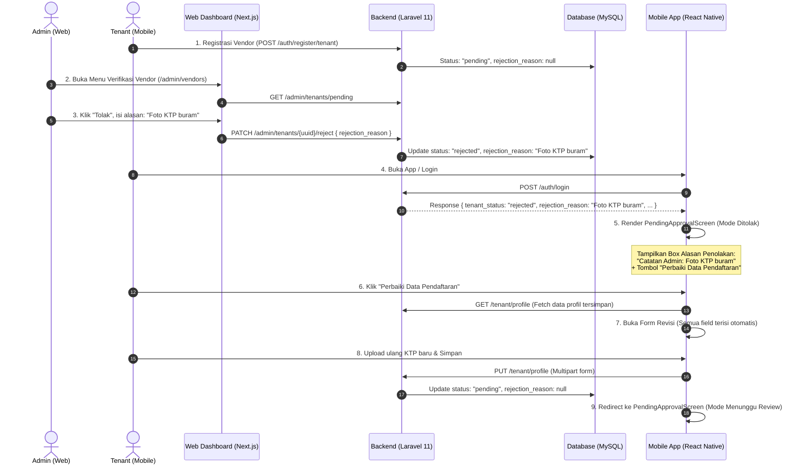

# [FEATURE] Penanganan Rejection Reason & Alur Revisi Pendaftaran Tenant Tanpa Mengulang dari Awal

**Labels:** `enhancement`, `backend`, `frontend-web`, `frontend-mobile`, `good-first-issue`  
**Assignee:** *TBD (Junior Developer / AI Agent)*  
**Priority:** `High`  
**Milestone:** `MVP Sprint - Onboarding & Vendor Verification`

---

## 📌 Ringkasan Masalah & Kebutuhan (Context & Problem Statement)

Saat ini, ketika calon vendor/tenant mendaftarkan usahanya di aplikasi JogjaHub:
1. **Admin di Web Dashboard** dapat menolak (*reject*) pendaftaran melalui tabel verifikasi vendor, namun UI input alasan penolakan masih sederhana (inline textarea) dan belum memiliki preset/panduan alasan standar maupun preview dokumen yang aman.
2. **Saat pendaftaran ditolak oleh Admin**, alasan penolakan (`rejection_reason`) **tidak dikirimkan** pada payload respon login backend (`POST /api/v1/auth/login`), sehingga aplikasi mobile tidak dapat menampilkan alasan spesifik mengapa pendaftaran ditolak.
3. **Di aplikasi mobile (`jogjahub-mobile`)**, halaman `PendingApprovalScreen` hanya menampilkan pesan generik bahwa akun ditolak, dengan satu-satunya pilihan tombol *"Kembali ke Login"*.
4. **Masalah Paling Kritis:** Tenant yang ditolak **terjebak (*deadlock*)**. Mereka tidak bisa mengubah data yang salah atau mengunggah ulang dokumen yang diminta tanpa mengulang pendaftaran dari awal. Jika mencoba daftar ulang dari awal dengan email/nomor HP yang sama, sistem akan menolak karena email sudah terdaftar di database.

### 🎯 Tujuan yang Ingin Dicapai (Goal)
1. **Admin Web:** Memiliki Modal UI Penolakan yang ramah pengguna, dilengkapi pilihan cepat (*chips/presets*) alasan umum (mis. KTP buram, NIB tidak valid, lokasi di luar DIY), validasi input, dan counter karakter (maks. 500 karakter).
2. **Backend API:** Memastikan `rejection_reason` dikirimkan saat tenant login atau mengambil profil, serta endpoint pembaruan profil (`PUT /api/v1/tenant/profile`) mengembalikan status ke `pending` dan mengosongkan `rejection_reason`.
3. **Mobile App:** Tenant yang ditolak melihat kartu informasi alasan penolakan secara transparan, serta memiliki tombol **"Perbaiki Data Pendaftaran"** yang membuka formulir dengan data lama yang **sudah terisi otomatis (*pre-filled*)**. Tenant cukup memperbaiki bagian yang salah/mengunggah dokumen baru, lalu mengirim ulang tanpa mengulang dari nol.

---

## 🗺️ Alur Sistem (Sequence Diagram)



---

## 📋 Kriteria Penerimaan (Acceptance Criteria - Gherkin Style)

### Skenario 1: Admin Menolak Pendaftaran dengan Alasan Spesifik di Web
- **Given** Admin membuka halaman `http://localhost:3000/admin/vendors` dan terdapat tenant berstatus *pending*.
- **When** Admin menekan tombol *"Tolak"* pada baris tenant.
- **Then** Muncul modal konfirmasi penolakan dengan field alasan (wajib diisi, maks. 500 karakter) dan tombol preset alasan cepat.
- **When** Admin memilih preset alasan atau mengetik alasan sendiri, lalu menekan *"Kirim Penolakan"*.
- **Then** Request `PATCH /api/v1/admin/tenants/{uuid}/reject` dikirim dengan payload `{ rejection_reason: "..." }`.
- **And** Tenant hilang dari daftar antrean verifikasi dan muncul notifikasi/toast sukses.

### Skenario 2: Tenant Melihat Alasan Penolakan di Aplikasi Mobile
- **Given** Akun tenant telah ditolak oleh Admin dengan alasan `"Foto KTP buram dan terpotong"`.
- **When** Tenant membuka aplikasi atau melakukan login di `jogjahub-mobile`.
- **Then** Tenant diarahkan ke layar `PendingApprovalScreen` dalam mode penolakan (*rejected*).
- **And** Terdapat kartu peringatan berwarna merah/oranye yang memuat teks:
  - Judul: *"Pendaftaran Perlu Diperbaiki"*
  - Catatan Admin: *"Foto KTP buram dan terpotong"*
  - Penjelasan: *"Data pendaftaran Anda tersimpan. Silakan perbaiki data yang diminta tanpa mendaftar ulang dari awal."*
- **And** Tersedia tombol utama: **"Perbaiki Data Pendaftaran"** dan tombol sekunder: *"Kembali ke Login"*.

### Skenario 3: Tenant Melakukan Revisi dan Mengirim Ulang Pendaftaran
- **Given** Tenant berada di layar `PendingApprovalScreen` yang menampilkan catatan penolakan.
- **When** Tenant menekan tombol **"Ajukan Ulang Pendaftaran"**.
- **Then** Aplikasi membuka **form registrasi tenant awal** (`RegisterVendorScreen`) dalam mode *resubmit* — bukan form edit profil yang berbeda.
- **And** Semua data lama (Nama Usaha, Kategori Layanan, Alamat Lengkap, Koordinat Peta, Email, dan WhatsApp) ditampilkan **read-only** sudah terisi sesuai data pendaftaran sebelumnya — tenant tidak perlu mengisi ulang.
- **And** Terdapat banner **"Catatan Revisi dari Admin"** di bagian atas formulir yang tetap menampilkan alasan penolakan.
- **When** Tenant mengunggah dokumen yang diminta (KTP/NIB/Portofolio — minimal 1) dan menekan tombol **"Simpan & Ajukan Ulang"**.
- **Then** Aplikasi mengirim request `POST /api/v1/tenant/profile/resubmit` berisi **hanya file dokumen**.
- **And** Backend mengganti dokumen yang diunggah ulang, mempertahankan seluruh data profil lama, mengubah status menjadi `pending`, dan mereset `rejection_reason` menjadi `null`.
- **And** Jika upload gagal, muncul pesan error yang jelas dan status tetap `rejected`.
- **And** Jika sukses, aplikasi mengarahkan kembali tenant ke layar status antrean: **"Menunggu Persetujuan Admin"**.

---

## 🛠️ Petunjuk Teknis Implementasi (Technical Specification)

Bagian ini ditulis secara mendalam agar dapat langsung diikuti oleh programmer junior atau model AI.

### 1. Perubahan Backend (`jogjahub-backend`)

#### A. File: `app/Http/Controllers/Api/AuthController.php`
- **Tujuan:** Mengembalikan `rejection_reason` saat tenant login.
- **Lokasi Kode:** Di dalam method `login(LoginRequest $request)`, sekitar baris 56–66.
- **Perubahan:**
```diff
         // Jika user adalah tenant, sertakan status tenant profile
         if ($user->role === 'tenant') {
             $tenantProfile = TenantProfile::where('user_id', $user->id)->first();
             if ($tenantProfile) {
                 $response['data']['tenant_status']  = $tenantProfile->status;
                 $response['data']['business_name']  = $tenantProfile->business_name;
+                $response['data']['rejection_reason'] = $tenantProfile->rejection_reason;
             } else {
                 $response['data']['tenant_status'] = 'pending';
                 $response['data']['business_name'] = $user->name;
+                $response['data']['rejection_reason'] = null;
             }
         }
```

#### B. Verifikasi Endpoint Terkait yang Sudah Ada (Jangan Dirusak):
- `app/Http/Controllers/Api/Tenant/ProfileController.php`:
  - Method `update(UpdateProfileRequest $request)` sudah mengatur `'status' => 'pending'` dan `'rejection_reason' => null`. Pastikan logika ini tetap berjalan saat tenant melakukan update.
  - Method `show(Request $request)` mengembalikan `TenantProfileResource` yang sudah memuat `rejection_reason` ketika diakses oleh pemilik profil.
- `app/Http/Requests/Tenant/UpdateProfileRequest.php`:
  - Pastikan field file (`ktp`, `nib`, `portfolio`) bertipe `sometimes|file` jika tenant hanya ingin mengubah informasi teks tanpa mengunggah ulang file yang sudah benar.

#### C. File Baru: `app/Http/Controllers/Api/Tenant/ProfileController.php` → method `resubmit()` (issue #59)
- **Route:** `POST /api/v1/tenant/profile/resubmit` (auth:sanctum + role:tenant, di `routes/api.php`).
- **Request:** `app/Http/Requests/Tenant/ResubmitRequest` — `ktp`/`nib`/`portfolio` opsional per-item tapi **minimal satu wajib** (validasi `withValidator`).
- **Aturan:**
  1. Hanya tenant berstatus `rejected` yang boleh memanggil endpoint ini (selain itu → 422).
  2. Hanya dokumen yang diunggah ulang yang diganti — data profil lama (nama, alamat, kategori, dll) **dipertahankan**.
  3. File lama yang tergantikan dihapus dari disk `local` setelah update sukses.
  4. Status diubah `rejected → pending` dan `rejection_reason` di-null-kan.
  5. Jika validasi gagal → 422, status di DB tetap `rejected`.
- **Test:** `tests/Feature/Tenant/TenantResubmitTest.php` (5 skenario: sukses, tanpa dokumen, file tidak valid, pending ditolak, approved ditolak).

---

### 2. Perubahan Web Admin (`jogjahub-web`)

#### File: `src/app/admin/vendors/page.tsx`
- **Tujuan:** Mengganti inline textarea penolakan dengan Komponen Modal Dialog yang elegan dan memiliki tombol *preset/quick chip*.
- **Spesifikasi UI Modal Penolakan:**
  1. **State yang dibutuhkan:**
     ```typescript
     const [isRejectModalOpen, setIsRejectModalOpen] = useState(false);
     const [selectedTenant, setSelectedTenant] = useState<PendingTenant | null>(null);
     const [rejectionReason, setRejectionReason] = useState("");
     const [isSubmitting, setIsSubmitting] = useState(false);
     ```
  2. **Daftar Preset Alasan (Quick Chips):**
     ```typescript
     const PRESET_REASONS = [
       "Foto KTP buram / tidak terbaca",
       "Dokumen NIB / Legalitas tidak sesuai nama pemilik",
       "Titik koordinat lokasi berada di luar Daerah Istimewa Yogyakarta",
       "Kategori layanan tidak sesuai dengan portofolio yang dilampirkan",
       "Nomor kontak WhatsApp tidak aktif atau tidak dapat dihubungi",
     ];
     ```
  3. **Komponen Modal:**
     - Tampilkan nama bisnis yang sedang diproses: `Tolak Pendaftaran: {selectedTenant.business_name}`.
     - Area textarea dengan counter karakter: `${rejectionReason.length}/500`.
     - Tombol chip preset yang jika diklik akan otomatis mengisi atau menambahkan teks ke textarea.
     - Tombol aksi:
       - *"Batal"*: Menutup modal dan membersihkan input.
       - *"Kirim Penolakan"*: Disabled jika `rejectionReason.trim().length === 0` atau `isSubmitting === true`.
  4. **Penanganan Submit:**
     ```typescript
     async function handleConfirmReject() {
       if (!selectedTenant || !rejectionReason.trim()) return;
       setIsSubmitting(true);
       try {
         await adminApi.rejectTenant(selectedTenant.uuid, rejectionReason.trim());
         setTenants((prev) => prev.filter((t) => t.uuid !== selectedTenant.uuid));
         setIsRejectModalOpen(false);
         setSelectedTenant(null);
         setRejectionReason("");
       } catch (err) {
         alert(err instanceof Error ? err.message : "Gagal menolak vendor.");
       } finally {
         setIsSubmitting(false);
       }
     }
     ```

---

### 3. Perubahan Mobile App (`jogjahub-mobile`)

#### A. File: `src/types/vendor.ts`
Perbarui tipe `TenantProfile` agar mengenali `rejection_reason`:
```typescript
export interface TenantProfile {
  id: number;
  business_name: string;
  description: string | null;
  address: {
    street: string;
    city: string;
    province: string;
    postal_code: string | null;
  };
  latitude: number;
  longitude: number;
  whatsapp_number: string;
  status: 'pending' | 'approved' | 'rejected';
  rejection_reason?: string | null; // <-- TAMBAHKAN FIELD INI
  categories: Array<{
    id: number;
    name: string;
  }>;
}
```

#### B. File: `src/features/auth/store/authSlice.ts`
Tambahkan `rejectionReason` ke state autentikasi:
```typescript
interface AuthState {
  user: User | null;
  token: string | null;
  tenantStatus?: string | null;
  businessName?: string | null;
  rejectionReason?: string | null; // <-- TAMBAHKAN INI
  tenantProfile?: TenantProfile | null;
  isHydrated: boolean;
}

const initialState: AuthState = {
  user: null,
  token: null,
  tenantStatus: null,
  businessName: null,
  rejectionReason: null, // <-- INITIAL VALUE
  tenantProfile: null,
  isHydrated: false,
};
```
Perbarui reducer `setSession`, `logout`, dan `restoreSession`:
- Pada `setSession`: simpan `state.rejectionReason = action.payload.rejectionReason ?? null;`
- Pada `logout`: reset `state.rejectionReason = null;`
- Pada `restoreSession`: pulihkan `state.rejectionReason = payload?.rejectionReason ?? null;`
- Tambahkan action helper `setTenantStatusPending(state)`:
  ```typescript
  setTenantStatusPending(state) {
    state.tenantStatus = 'pending';
    state.rejectionReason = null;
  }
  ```

#### C. File: `src/features/auth/store/authListener.ts` & `bootstrapAuth.ts`
Pastikan `rejectionReason` ikut tersimpan di `@jogjahub/session` AsyncStorage dan dipulihkan kembali saat aplikasi dibuka ulang.

#### D. File: `src/features/auth/hooks/useLogin.ts`
Ambil field `rejection_reason` dari respon login backend dan teruskan ke Redux:
```typescript
const { user, token, tenant_status, business_name, rejection_reason } = response.data.data;
dispatch(setSession({
  user: normalizedUser,
  token,
  tenantStatus: tenant_status ?? null,
  businessName: business_name ?? null,
  rejectionReason: rejection_reason ?? null,
}));
```

#### E. File: `src/navigation/RootNavigator.tsx`
Daftarkan **form registrasi awal** (`RegisterVendorScreen`) di dalam navigator antrean pending/rejected sehingga tenant rejected bisa membukanya dalam mode `resubmit`:
```tsx
{user &&
  normalizedRole === 'vendor' &&
  (tenantStatus === 'pending' || tenantStatus === 'rejected') && (
    <Stack.Navigator
      key="pending-stack"
      screenOptions={{ headerShown: false }}
    >
      <Stack.Screen
        name="PendingApproval"
        component={PendingApprovalScreen}
        initialParams={{
          businessName: businessName ?? undefined,
          rejected: tenantStatus === 'rejected',
        }}
      />
      <Stack.Screen
        name="RegisterVendor"
        component={RegisterVendorScreen}
        initialParams={{ mode: 'resubmit' }}
      />
    </Stack.Navigator>
)}
```
> ⚠️ `VendorOnboardingScreen` TIDAK lagi dipakai untuk alur pengajuan ulang — layar itu tetap ada dan dipakai oleh `VendorProfileStackNavigator` (edit profil vendor yang sudah approved).

#### F. File: `src/features/vendor/onboarding/screens/PendingApprovalScreen.tsx`
- Ambil `rejectionReason` dari Redux:
  ```typescript
  const rejectionReason = useSelector((state: RootState) => state.auth?.rejectionReason);
  ```
- Jika `isRejected === true`:
  - Tampilkan kotak peringatan penolakan dengan style kartu kontras (`colors.errorContainer`).
  - Tampilkan judul: **"Pendaftaran Ditolak / Perlu Revisi"**.
  - Tampilkan isi alasan penolakan:
    ```tsx
    <View style={styles.rejectionCard}>
      <Text style={styles.rejectionHeader}>Catatan dari Admin:</Text>
      <Text style={styles.rejectionText}>
        {rejectionReason || "Admin belum menyertakan rincian alasan. Silakan periksa kembali data profil Anda."}
      </Text>
    </View>
    ```
  - Tampilkan instruksi: *"Data pendaftaran Anda tidak hilang. Silakan perbaiki data yang diminta lalu ajukan kembali."*
  - Tambahkan tombol aksi:
    ```tsx
    <View style={styles.buttonContainer}>
      <Button
        label="Ajukan Ulang Pendaftaran"
        onPress={() => navigation.navigate("RegisterVendor", { mode: "resubmit" })}
      />
      <View style={{ height: 12 }} />
      <Button
        label="Keluar / Ganti Akun"
        variant="outline" // atau style sekunder
        onPress={handleBackToLogin}
      />
    </View>
    ```

#### G. File: `src/features/auth/screens/RegisterVendorScreen.tsx` (form registrasi awal + mode resubmit)
- Saat menerima route param `{ mode: 'resubmit' }`:
  - Ambil `tenantProfile`, `user`, dan `rejectionReason` dari Redux.
  - Jika `tenantProfile` belum ada, panggil `vendorApi.getMyProfile()` lalu simpan ke Redux via `setTenantProfile`.
  - Pre-fill data lama sebagai teks read-only: Nama Bisnis, Kategori, Alamat, Koordinat, Email (dari `user`), WhatsApp.
  - Tampilkan banner **"Catatan Revisi dari Admin"** berisi `rejectionReason`.
  - Tampilkan bagian unggah dokumen KTP / NIB / Portofolio — satu-satunya bagian yang interaktif.
- Saat tombol **"Simpan & Ajukan Ulang"** ditekan:
  - Validasi minimal 1 dokumen dipilih (Toast error jika kosong — status tetap `rejected`).
  - Kirim ke `vendorApi.resubmitProfile(formData)` — payload HANYA berisi file.
  - Jika sukses: dispatch `setTenantStatusPending()`, Toast sukses, `navigation.reset` ke `PendingApprovalScreen`.
  - Jika gagal: `resubmitError` ditampilkan, status di Redux tetap `rejected`.
- Mode default (`!isResubmit`) TIDAK diubah — registrasi tenant baru tetap seperti sebelumnya.
- `VendorOnboardingScreen` tetap dipakai untuk edit profil vendor approved (bukan untuk pengajuan ulang).

---

## 🧪 Panduan Pengujian Manual (Manual QA Checklist)

Lakukan pengujian berikut secara urut untuk memastikan tidak ada regresi:

- [ ] **Test Case 1: Rejection dari Web Admin**
  1. Login sebagai Admin di Web Dashboard (`http://localhost:3000/admin-login`).
  2. Buka menu Verifikasi Vendor.
  3. Klik tombol *"Tolak"* pada vendor berstatus *pending*.
  4. Pastikan modal penolakan muncul, pilih chip preset *"Foto KTP buram / tidak terbaca"*, lalu klik *"Kirim Penolakan"*.
  5. Cek database tabel `tenant_profiles`: kolom `status` harus bernilai `'rejected'` dan `rejection_reason` berisi catatan yang dikirim.

- [ ] **Test Case 2: Tampilan Alasan di Mobile App**
  1. Buka aplikasi mobile `jogjahub-mobile` dan login dengan akun vendor yang baru saja ditolak.
  2. Pastikan diarahkan ke `PendingApprovalScreen`.
  3. Verifikasi bahwa teks alasan penolakan *"Foto KTP buram / tidak terbaca"* muncul dengan jelas di kartu catatan admin.
  4. Tutup aplikasi dan buka kembali. Pastikan sesi tetap bertahan dan alasan penolakan tetap muncul (tidak hilang karena restart app).

- [ ] **Test Case 3: Ajukan Ulang Tanpa Mengulang Pendaftaran**
  1. Pada `PendingApprovalScreen` (mode rejected), klik tombol **"Ajukan Ulang Pendaftaran"**.
  2. Pastikan **form registrasi awal** terbuka (bukan form edit profil) dan data Nama Bisnis, Kategori, Alamat, Koordinat, Email, dan WhatsApp **sudah terisi otomatis** (read-only) tanpa kosong.
  3. Banner **"Catatan Revisi dari Admin"** masih menampilkan alasan penolakan.
  4. Unggah minimal satu dokumen (mis. KTP baru), lalu tekan **"Simpan & Ajukan Ulang"**.
  5. Pastikan muncul notifikasi sukses dan layar kembali ke `PendingApprovalScreen` dengan tampilan status **"Menunggu Persetujuan Admin"** (icon jam pasir ⏳ dan alasan penolakan bersih).
  6. Periksa database: dokumen baru tersimpan, dokumen lain yang tidak diunggah ulang tetap ada, `status` berubah kembali menjadi `'pending'`, dan `rejection_reason` bernilai `null`.
  7. **Skenario gagal:** kosongkan pilihan dokumen / pilih file non-gambar, tekan submit → error muncul, status di database tetap `rejected`.
  8. **Skenario status lain:** tenant `pending`/`approved` tidak melihat tombol pengajuan ulang dan `POST /tenant/profile/resubmit` menolak mereka (422).

- [ ] **Test Case 4: Verifikasi Ulang oleh Admin**
  1. Buka kembali dashboard Web Admin.
  2. Pastikan vendor yang baru saja mengajukan revisi muncul kembali di tabel Verifikasi Vendor (Pending).
  3. Klik *"Setujui"*.
  4. Vendor login / buka aplikasi mobile dan berhasil masuk ke `VendorTabNavigator` (Dashboard Toko).

---

## 📂 Ringkasan Berkas yang Diubah / Dibuat

| Proyek | Jalur Berkas | Perubahan |
|---|---|---|
| **Backend** | `jogjahub-backend/app/Http/Controllers/Api/AuthController.php` | Sertakan `rejection_reason` pada respon JSON `login()` |
| **Web Admin** | `jogjahub-web/src/app/admin/vendors/page.tsx` | Implementasikan Modal Dialog penolakan dengan presets & validasi |
| **Backend** | `jogjahub-backend/app/Http/Controllers/Api/Tenant/ProfileController.php` | Tambah method `resubmit()` — endpoint `POST /tenant/profile/resubmit` (issue #59) |
| **Backend** | `jogjahub-backend/app/Http/Requests/Tenant/ResubmitRequest.php` | File baru — validasi dokumen pengajuan ulang (minimal 1) |
| **Backend** | `jogjahub-backend/routes/api.php` | Daftarkan route `POST /tenant/profile/resubmit` |
| **Backend** | `jogjahub-backend/tests/Feature/Tenant/TenantResubmitTest.php` | File baru — 5 skenario pengajuan ulang (success & fail) |
| **Mobile** | `jogjahub-mobile/src/types/vendor.ts` | Tambahkan `rejection_reason` & `location` pada interface `TenantProfile` |
| **Mobile** | `jogjahub-mobile/src/features/auth/store/authSlice.ts` | Tambahkan `rejectionReason` ke state Redux & action helper |
| **Mobile** | `jogjahub-mobile/src/features/auth/store/bootstrapAuth.ts` | Persistensi & restorasi `rejectionReason` dari storage |
| **Mobile** | `jogjahub-mobile/src/features/auth/hooks/useLogin.ts` | Simpan `rejection_reason` ke Redux saat login |
| **Mobile** | `jogjahub-mobile/src/features/auth/hooks/useResubmit.ts` | File baru — hook pengajuan ulang (payload hanya dokumen) |
| **Mobile** | `jogjahub-mobile/src/api/vendorApi.ts` | Tambah `resubmitProfile()` memanggil `POST /tenant/profile/resubmit` |
| **Mobile** | `jogjahub-mobile/src/navigation/types.ts` | `RegisterVendor` menerima param `{ mode: 'resubmit' }` |
| **Mobile** | `jogjahub-mobile/src/navigation/RootNavigator.tsx` | Daftarkan `RegisterVendor` (mode resubmit) di `pending-stack` |
| **Mobile** | `jogjahub-mobile/src/features/vendor/onboarding/screens/PendingApprovalScreen.tsx` | Tombol "Ajukan Ulang Pendaftaran" → navigasi ke `RegisterVendor` mode resubmit |
| **Mobile** | `jogjahub-mobile/src/features/auth/screens/RegisterVendorScreen.tsx` | Mode `resubmit`: banner catatan admin, data lama read-only, unggah dokumen saja |
| **Mobile** | `jogjahub-mobile/src/features/vendor/onboarding/screens/VendorOnboardingScreen.tsx` | Tetap dipakai untuk edit profil vendor approved (bukan pengajuan ulang) |

---

> [!TIP]
> **Catatan untuk Pelaksana (Junior Developer / AI Agent):**
> Struktur backend sudah memiliki migrasi `rejection_reason` dan method `ProfileController@update` yang otomatis mereset status ke `pending`. Jangan membuat tabel baru atau mengubah nama kolom database. Cukup sambungkan aliran data antara Web $\rightarrow$ Backend $\rightarrow$ Mobile sesuai panduan di atas.

